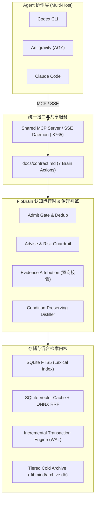
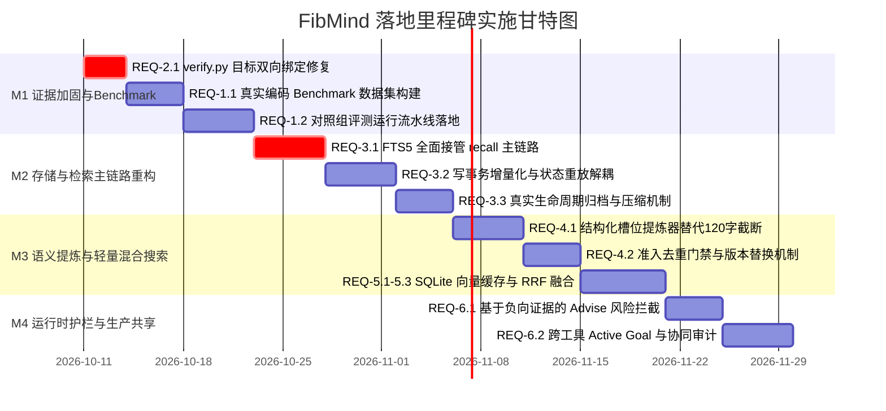

# 05: 面向编码 Agent 的本地、可追溯与可纠错记忆层工程规格书 (v0.2 - v1.0)

> **定位**：面向编码 Agent（Codex、AGY、Claude Code 等）的本地低开销、可追溯、可纠错的统一记忆基础设施。
> **状态**：草案 / 实施规划中
> **基线分支**：`main` (commit 对应 2026-10-10)
> **前置依赖**：[`01-governance.md`](01-governance.md), [`02-identity.md`](02-identity.md), [`03-brain.md`](03-brain.md), [`04-evolve.md`](04-evolve.md)

---

## 1. 背景、定位与竞品全景分析

### 1.1 项目基础与核心现状
FibMind 当前已具备较为扎实的工程与架构基础：
1. **记忆质量治理完备**：严格区分“熟悉度（召回频次）”与“置信度（证据确认）”，避免错误记忆因高频召回自我强化；具备修订（`revise`）、过期（`stale`）、驳回（`refute`）、删除（`forget`）与事件回放机制。
2. **可解释与高可维**：全生命周期事件日志（Event Sourcing）；检索具备可解释性输出（`fibmind_explain_recall`）；删除时联动处理历史日志与衍生摘要，杜绝幽灵记忆复活。
3. **本地多工具协同原生**：支持 SQLite WAL、MCP 协议、共享 Daemon 进程（消除文件锁冲突），并以统一的五级身份（`owner`, `workspace_id`, `project_id`, `session_id`, `task_id`）支持跨宿主（Codex, Claude Code, AGY）共享。
4. **工程一致性高**：具备 300+ 单元测试覆盖、静态类型检查、lint 门禁与初步评测流程。

### 1.2 当前短板与瓶颈剖析
经深度源码审查与验证，当前系统存在六项关键瓶颈与两处关键实现缺陷：
1. **自动验证与记忆结论存在假阳性绑定漏洞（致命逻辑缺陷）**：
   在 [`src/fibmind/verify.py`](../src/fibmind/verify.py) 中，当执行命令退出码为 0 时直接返回 `confirmed`；`target_files` 的目标触达判定仅在 `exit_code != 0` 的失败路径执行。导致任意无关命令成功执行（如 `echo 1` 或与修改文件无关的测试）都会误推高目标记忆置信度。
2. **FTS5 索引与普通召回主链路脱节**：
   虽然实现了持久化 FTS5 索引并在 [`src/fibmind/service.py`](../src/fibmind/service.py) 中提供了 `search_fts`，但核心召回路径 [`src/fibmind/retrieval.py`](../src/fibmind/retrieval.py) 依然走内存全量词法倒排与 Python 级 BM25 计算，并未实现真正的存储级过滤。
3. **写事务全量反序列化性能瓶颈**：
   [`src/fibmind/storage.py`](../src/fibmind/storage.py) 的 `transaction()` 采用全量加载所有节点/边/事件到内存、计算快照 diff 再批量写回的机制。随着历史数据增长，写延迟与内存消耗呈线性劣化。
4. **默认摘要缺少语义结构提炼**：
   [`src/fibmind/distill.py`](../src/fibmind/distill.py) 中 `ExcerptSummarizer` 仅对内容硬截断 120 字符，丢失前置条件、适用版本与例外边界。
5. **评测基准属于微型玩具集（Toy Benchmark）**：
   7 个小数据集仅含 36 条记忆与 27 个查询，指标“答案词覆盖率”仅检查子串包含而非 Agent 实际决策正误，未量化对真实编码任务的成败收益。
6. **斐波那契分层未建立真正的物理归档闭环**：
   当前属于检索阶段的逻辑容量切片，底层数据库仍全量保留过期节点与日志，存储无界增长。

### 1.3 竞品全景对比矩阵（截至 2026-10）

| 竞品 | 定位与优势 | 相对 FibMind 的代价/局限 | 适用场景 | FibMind 的差异化壁垒 |
| :--- | :--- | :--- | :--- | :--- |
| **LongMemory** (CaviraOSS) | 本地 SQLite、MCP、来源/时序管理、可解释召回、多宿主 | TS 引擎；对象与检索模式较多，运维维护面大 | 本地跨工具通用记忆 | FibMind 强化**代码级因果证据与反事实校验**，Python 栈与 AI 生态更亲和 |
| **Mem0** | 通用多框架记忆层，SDK 与生态完备 | 默认深度依赖云端 LLM 与重型 Embedding；开源版与商业托管存在功能剪裁 | 聊天客服、个人助手 | FibMind 专注**本地单机毫秒级响应、代码与工程确定性追溯**，无需依赖外部 API |
| **Graphiti** (Zep) | 动态时序知识图谱，擅长实体时点演变与混合检索 | 强依赖图数据库与重型 LLM 抽取，本地部署极重 | 复杂关系与事实演进 | FibMind 保持 **SQLite 轻量单文件**，图用于辅助溯源而非沉重推理 |
| **Letta Code** | 完整有状态 Agent 运行时，技能与记忆深度内聚 | 侵入式全栈 Agent 架构，无法轻易作为轻量中间件接入已有生态 | 全新自主 Agent 项目 | FibMind 是**非侵入式 Memory Layer**，通过 MCP 即插即用供已有 Agent 挂载 |
| **Cognee** | 丰富文档/代码摄入建图流水线 | 处理链条长，依赖较多基础设施与模型转换 | 代码与文档大型企业知识库 | FibMind 专注**编码过程中的轻量经验沉淀与防重复踩坑** |
| **MemOS** | 多模态空间、工具轨迹回放与技能复用 | 完整服务较重，本地插件与云服务边界割裂 | 多模态及跨模态复杂 Agent | FibMind 聚焦**代码 Agent 命令行与测试闭环** |

### 1.4 FibMind 核心战略定位与边界原则
* **核心定位**：专为本地编码 Agent 设计的、以“**因果证据不可伪造、历史经验随时可纠、多工具并发共享、零重型服务依赖**”为准则的轻量级记忆引擎。
* **明确非目标 (Non-Goals)**：
  - 不做通用的自然语言聊天会话历史管理器（不与 Mem0 泛聊天场景争锋）。
  - 不做需要独立部署 Neo4j/Milvus 等重型集群的企业级分布式图数据库（不与 Graphiti/Cognee 争重型 infra）。
  - 不做替代宿主思考与工具调度的通用全功能 Agent 框架（不与 Letta/CrewAI 重叠）。

---

## 2. 核心架构与设计原则



### 核心设计原则
1. **证据驱动胜于频次驱动 (Evidence over Frequency)**：
   熟悉度（Familiarity）记录检索命中次数，置信度（Confidence）严格由通过因果验证的证据计算。未经验证的推测无论被读取多少次，置信度恒为 0。
2. **因果归因胜于盲目退出码 (Strict Attribution over Exit-Code 0)**：
   验证命令执行成功必须提供对目标文件或测试用例的覆盖归因凭证；未触达目标的成功执行只能标记为 `inconclusive`，杜绝假阳性置信度膨胀。
3. **增量持久化与延迟水合 (Incremental Write & Lazy Hydration)**：
   摒弃写事务全量反序列化与快照 diff；检索阶段直接由 FTS5 + 向量索引产出 Top-K 主键，按需延迟水合节点元数据。
4. **结构完整性胜于无差别字符截断 (Structure & Conditions Preservation)**：
   摒弃 120 字符暴力截断，结构化提取“适用条件（Preconditions）、例外场景（Exceptions）、操作准则（Directives）”，保障长期记忆的高保真度。
5. **极简本地多宿主共享 (Zero-Friction Local Sharing)**：
   基于单个 SQLite 数据库与常驻共享 Daemon 进程，通过统一的 5 级身份（`owner`, `workspace_id`, `project_id`, `session_id`, `task_id`）实现各 Agent 间的隔离与协作。

---

## 3. 详细工程需求规约 (EPIC Specifications)

### EPIC-1: 真实编码任务端到端 Benchmark 套件 (Real-World Benchmark)

#### REQ-1.1: 真实任务测试集规范与用例构建
* **目标**：淘汰当前仅做字符串子串命中的玩具数据集，建立贴近实际软件工程缺陷修复与特性开发的测试集。
* **规格要求**：
  1. 建立包含 25 个具备明确前置经验与踩坑陷阱的真实场景测试集（`evals/datasets/real_coding_benchmark.json`）。
  2. 每个用例包含：
     - 初始代码库上下文与目标任务。
     - 历史踩坑背景（如：“该版本 SQLAlchemy 2.0 禁止隐式 autocommit，必须显式 `session.commit()`”）。
     - 干扰记忆（同名不同模块的陈旧经验、其他项目的非适用经验）。
     - 验证测试命令与通过断言。
  3. 数据格式遵循如下 Schema：
```json
{
  "$schema": "http://json-schema.org/draft-07/schema#",
  "task_id": "sqlalchemy_20_migration_deadlock",
  "objective": "Fix transaction deadlock during bulk insert in worker",
  "target_files": ["src/db/worker.py"],
  "historical_knowledge": [
    {
      "title": "SQLAlchemy 2.0 requires explicit commit on engine-level connections",
      "content": "Engine connection requires conn.commit() or begin() block; raw execute will not persist.",
      "category": "decision",
      "files": ["src/db/worker.py"]
    }
  ],
  "trap_queries": ["How to commit transaction in db worker?"],
  "expected_guidance_keys": ["explicit commit", "conn.begin()", "no autocommit"],
  "forbidden_stale_keys": ["autocommit=True"]
}
```

#### REQ-1.2: 四组受控对照实验流水线
* **目标**：量化记忆系统为 Agent 带来的真实收益与成本。
* **对照组设置**：
  - **Group 0 (Zero-Shot)**：仅提供系统提示词与当前任务，无任何历史记忆注入。
  - **Group 1 (Static AGENTS.md)**：将全部历史经验平铺拼接在一个 Markdown 文件中全文注入上下文。
  - **Group 2 (FibMind Current v0.1)**：当前主分支的检索与预算策略。
  - **Group 3 (FibMind Optimized v0.3+)**：本规格书落地的混合检索、结构化提炼与精细预算控制。
  - **Group 4 (External Open-Source Baseline)**：LongMemory / Mem0 开源版本。

#### REQ-1.3: 核心评估指标体系
1. **重复犯错率 (Repeat-Error / Regression Rate)**：
   $$\text{Repeat-Error Rate} = \frac{\text{触发已知踩坑陷阱的用例数}}{\text{总包含陷阱的用例数}}$$
2. **任务一次性通过率 (First-Attempt Pass Rate)**：
   执行给定验证命令（`pytest` 等）一次性 exit 0 且验证通过的比例。
3. **真实 Token 消耗量 (Actual Prompt Tokens)**：
   接入真实分词器（`tiktoken` cl100k / o200k，或目标模型 tokenizer），统计平均每次 prompt 注入的绝对 token 数。
4. **决策延迟开销 (Latency Overhead)**：
   记忆检索与拼装耗时的 P50 / P95（毫秒级）。

---

### EPIC-2: 证据链条判定与因果强绑定重构 (Evidence Attribution)

#### REQ-2.1: 修复 `verify.py` 目标覆盖逻辑漏洞
* **现状缺陷**：
  [`src/fibmind/verify.py:59-68`](../src/fibmind/verify.py#L59-L68) 中：
  ```python
  if exit_code != 0 and target_files:
      # 仅在失败时检查 target_files 是否在输出中
      ...
  if exit_code == 0:
      return "confirmed", "verification command passed"
  ```
  当执行任意命令成功退出（`exit_code == 0`）时，无论是否触达 `target_files`，均盲目返回 `confirmed`。
* **重构规约**：
  1. 必须对成功路径和失败路径实施**对称的双向 Scope 检查**。
  2. 若调用方传入了 `target_files`（或对应 MemoryNode 的 `metadata["files"]` 非空）：
     - 若 `exit_code == 0`，必须在 `stdout + stderr` 或测试输出中找到与 `target_files` 至少一个文件匹配的痕迹（文件名、模块名、用例路径）。
     - 若未找到任何目标文件的执行痕迹，即使退出码为 0，也**必须返回 `inconclusive`**，原因为：`"command succeeded but target files were not touched or verified"`。
  3. 增加对“空执行测试”的严格过滤：除了 `"collected 0 items"`，补充覆盖主流测试框架的零用例输出（如 `unittest`: `"Ran 0 tests"`, `jest`: `"0 passed, 0 total"`, `go test`: `"[no test files]"`）。

```python
# 核心判定重构示意
def evaluate_verification_outcome(
    exit_code: int,
    stdout: str,
    stderr: str,
    target_files: list[str] | tuple[str, ...] | None = None,
    assertion_patterns: list[str] | None = None,
) -> tuple[str, str]:
    combined = (stderr + "\n" + stdout).lower()

    # 1. 环境/不可抗力基础设施错误
    if exit_code in (126, 127) or any(p in combined for p in ENV_FAILURE_PATTERNS):
        return "inconclusive", "environment or infrastructure failure"

    # 2. 空测试检查
    if is_zero_tests_executed(combined):
        return "inconclusive", "no tests collected or executed"

    # 3. 目标覆盖与归因检查 (双向对称)
    if target_files:
        normalized_targets = [Path(f).name.lower() for f in target_files if f]
        touched = any(t in combined for t in normalized_targets)
        if not touched:
            if exit_code == 0:
                return "inconclusive", f"verification passed but did not touch target files: {target_files}"
            return "inconclusive", f"failure occurred in unrelated modules; did not touch {target_files}"

    # 4. 显式断言检查
    if assertion_patterns:
        matched_assertions = [pat for pat in assertion_patterns if re.search(pat, combined, re.IGNORECASE)]
        if not matched_assertions:
            return "inconclusive", f"command succeeded but missed required assertion pattern: {assertion_patterns}"

    # 5. 确定性因果结论
    if exit_code == 0:
        return "confirmed", "verification command passed with confirmed target coverage"
    return "refuted", f"verification command failed with exit code {exit_code}"
```

#### REQ-2.2: 结构化执行归因指纹 (Attribution Fingerprint)
* **目标**：将每一次证据与具体的 Git 提交、文件修改 diff、测试执行名称建立唯一因果哈希。
* **实现规约**：
  1. 在 `MemoryEvent` 中新增 `attribution` 结构：
     ```json
     {
       "commit_sha": "a1b2c3d4",
       "command": "pytest tests/test_worker.py -k test_commit",
       "exit_code": 0,
       "matched_targets": ["src/db/worker.py"],
       "test_count": 3,
       "git_diff_hash": "sha256:...",
       "timestamp": "2026-10-10T11:00:00Z"
     }
     ```
  2. 记录在 SQLite 新增的 `evidence_attributions` 关联表中，支持双向追溯。

#### REQ-2.3: 负向证据向派生知识的拓扑传播
* **目标**：当某条具体决策或修复被 `refuted` 驳回时，由其晋升或派生的上层通用知识不能继续保持高置信度。
* **规约**：
  1. 遍历图中入边关系为 `RelationType.DERIVED_FROM` 或 `SUPPORTED_BY` 的父节点。
  2. 按幸存支持节点比例重算置信度：
     $$\text{Confidence}_{\text{derived}} = \text{Confidence}_{\text{orig}} \times \left(\frac{\text{Valid Support Count}}{\text{Total Support Count}}\right)$$
  3. 若所有支撑节点均被驳回（Valid Support Count == 0），该知识节点自动降为 `MemoryStatus.STALE` 或 `REFUTED`，并在下次 `recall` 中默认屏蔽，记录审计日志。

---

### EPIC-3: 存储引擎与检索主链路性能优化 (Storage Engine Scalability)

#### REQ-3.1: SQLite FTS5 全面接管召回主链路
* **现状缺陷**：
  [`src/fibmind/retrieval.py:392`](../src/fibmind/retrieval.py#L392) 仍通过 `memory.lexical.candidates` 在 Python 内存字典中遍历倒排索引，使得每次召回前必须完整加载所有节点。
* **重构规约**：
  1. 废除检索前反序列化全量 `FibMind` 内存对象的依赖，将词法检索下推至 SQLite 原生 `node_fts` 虚表：
     ```sql
     SELECT node_id, bm25(node_fts) as score
     FROM node_fts
     WHERE node_fts MATCH :query
     ORDER BY score
     LIMIT :candidate_limit;
     ```
  2. **中英文混合分词适配**：
     - SQLite FTS5 默认采用 `unicode61` 分词器。
     - 为支持中文词组搜索，写入 FTS5 前增加前置规范化层（可选结巴/按字符与词块混合分词，或启用 SQLite trigram 扩展）。
  3. **延迟水合（Lazy Hydration）**：
     - 检索候选生成阶段仅获取 `node_id` 与 FTS 得分。
     - 仅对进入 Top-K 重排与图扩展的候选节点执行 `SELECT * FROM nodes WHERE id IN (...)`，避免将数据库成千上万个非相关节点载入 Python 堆内存。

#### REQ-3.2: 写事务增量化重构 (Incremental Write Transactions)
* **现状缺陷**：
  [`src/fibmind/storage.py:421`](../src/fibmind/storage.py#L421) 的 `transaction()` 采用：
  `memory = self._load(connection)` $\to$ 内存修改 $\to$ `self._write(connection, memory, before)` 快照全量比对。节点数过千后，写操作延迟急剧增加。
* **重构规约**：
  1. 引入轻量级增量写接口 `SqliteStore.append_event(event: MemoryEvent)` 与 `SqliteStore.update_node(node: MemoryNode)`。
  2. 写事务采用增量模式：
     - 直接在 SQLite 事务中 `INSERT INTO events (...)`。
     - 根据事件类型执行针对性 `UPSERT`：
       ```sql
       INSERT INTO nodes (id, title, content, confidence, familiarity, status, updated_at, ...)
       VALUES (:id, :title, :content, :confidence, :familiarity, :status, :updated_at, ...)
       ON CONFLICT(id) DO UPDATE SET
           confidence = excluded.confidence,
           familiarity = excluded.familiarity,
           status = excluded.status,
           updated_at = excluded.updated_at;
       ```
     - 同步增量触发 FTS5 虚表更新。
  3. 保留全量 `rebuild_from_log` 仅用于灾难恢复与本地文件迁移。

#### REQ-3.3: 真实分层容量管理与冷数据归档
* **目标**：斐波那契分层不仅在检索截断时生效，底层数据库具备物理归档与收缩能力。
* **规约**：
  1. 定义生命周期状态机：`active` $\to$ `promoted` $\to$ `archived` $\to$ `purged`。
  2. 提供 `fibmind compact` 运维命令：
     - 将已被替换超过 30 天且无引用依赖的 `stale` 记忆与底层 `episode` 事件迁移至 `.fibmind/archive.db`。
     - 执行 SQLite `VACUUM`，控制活跃库体积在 10MB 以内，读写延迟保持在 5ms 以内。

---

### EPIC-4: 结构化语义提炼与知识治理增强 (Semantic Distillation)

#### REQ-4.1: 结构化槽位语义提炼器 (Condition-Preserving Distiller)
* **现状缺陷**：
  [`src/fibmind/distill.py:54-70`](../src/fibmind/distill.py#L54-L70) 中的 `ExcerptSummarizer` 仅取前 120 字符拼接，导致“仅在 Python 3.12 且开启 `--no-cache` 时有效”等边界条件被截断丢失。
* **重构规约**：
  1. 新增 `StructuredDistiller` 接口与默认实现。
  2. 每一条沉淀的记忆提炼为包含四要素的结构化卡片：
     - **Directive/Rule**（核心结论）：一句话行动规范。
     - **Preconditions**（适用条件）：环境变量、语言版本、依赖库限制。
     - **Exceptions/Traps**（例外与已知陷阱）：何时该规则不适用，有何副作用。
     - **Verification Proof**（验证凭据）：关联的测试命令与代码文件。
  3. 渲染到 Context 时格式化为：
     ```markdown
     - [RULE] sqlalchemy_2.0_commit: Use explicit conn.commit() in engine transactions.
       • Conditions: SQLAlchemy >= 2.0.0
       • Exception: Not needed when using sessionmaker with autocommit context manager.
       • VerifiedBy: pytest tests/test_db.py (exit 0)
     ```

#### REQ-4.2: 准入去重门禁与语义近邻合并 (Admit Dedup & Versioning)
* **目标**：防止 Agent 在多个 session 中反复记录同一事实的变体，导致上下文膨胀。
* **规约**：
  1. 在 `decide_admission` 中引入两级去重：
     - **Level 1 (Exact Match)**：基于 `content_hash` 与规范化文本完全匹配，直接拒绝入库或仅累加原节点 `familiarity`。
     - **Level 2 (Near Duplicate / Similarity > 0.85)**：
       通过 FTS 词重合度与向量距离检测到已存在同类记忆时，判定属于同一经验的演进：
       - 若新旧内容一致：更新原有记忆的 `sources` 与最后活跃时间。
       - 若新旧内容相悖（见 REQ-4.3）：触发就地修订或生成新版本并废弃旧版本。

#### REQ-4.3: 矛盾检测与就地修订 (Contradiction Handling)
* **规约**：
  1. 当新经验与同一 `workspace_id` + 同一 `target_file` 下的既有活跃记忆结论存在显著冲突（如：“启用 X 特性” vs “禁止 X 特性”）：
  2. 禁止两条相互矛盾的记忆同时保持 `status=active`。
  3. 默认将旧记忆状态更新为 `stale`，并创建边 `Edge(new_id, old_id, RelationType.SUPERSEDES)`。
  4. 新记忆置信度继承原验证结果或归零待验。

---

### EPIC-5: 本地轻量混合检索与向量持久化缓存 (Local Hybrid Retrieval)

#### REQ-5.1: 基于 Content Hash 的 SQLite 向量持久化表
* **现状缺陷**：
  目前 embedding 计算在内存中缓存，重启后丢失；且开启后缺乏持久化存储，导致重复向量化开销大。
* **重构规约**：
  1. 在 SQLite 中增加向量持久化表：
     ```sql
     CREATE TABLE IF NOT EXISTS vector_cache (
         content_hash TEXT PRIMARY KEY,
         provider TEXT NOT NULL,
         dimensions INTEGER NOT NULL,
         embedding_blob BLOB NOT NULL,
         created_at TEXT NOT NULL
     );
     ```
  2. 采用 IEEE 754 32位浮点数数组二进制序列化（`struct.pack` / `numpy.tobytes`），体积极小（384 维向量仅约 1.5 KB）。

#### REQ-5.2: 零重型依赖本地 Embedding 后端
* **目标**：杜绝引入数 GB 的 PyTorch / Transformers 依赖，保持本地轻量启动。
* **选型推荐**：
  - 选项 A（默认极简）：基于 `fastembed` 或轻量 `onnxruntime`，内置量化版 `bge-small-zh-v1.5`（模型约 45MB，CPU 推理延迟 < 10ms）。
  - 选项 B：兼容 OpenAI / Ollama 外部 HTTP 向量服务。
  - 选项 C（无模型降级）：当环境无外部模型且未安装 onnx 时，自动无缝降级为**纯 FTS5 检索**，不阻断系统任何核心功能。

#### REQ-5.3: FTS5 + 向量 RRF 倒数排名融合算法
* **融合公式规约**：
  对所有候选文档 $d$：
  $$\text{Score}_{\text{RRF}}(d) = \frac{w_{\text{lex}}}{k + \text{Rank}_{\text{fts}}(d)} + \frac{w_{\text{sem}}}{k + \text{Rank}_{\text{dense}}(d)} + \alpha \cdot \text{Confidence}(d)$$
  其中平滑常量 $k = 60$，$w_{\text{lex}} = 0.5$，$w_{\text{sem}} = 0.5$；$\alpha$ 为置信度提升权重（默认 0.2）。
* 过滤噪声底噪：当向量余弦相似度低于阈值 $\tau = 0.35$ 时，不计入 Dense 排名，防止语义漂移引入幻觉。

---

### EPIC-6: 认知运行时深化与多 Agent 协同 (Cognitive Runtime)

#### REQ-6.1: 基于负向证据的风险拦截护栏 (`fibbrain_advise`)
* **目标**：在 Agent 执行高危操作前，根据历史失败与驳回记录主动告警拦截。
* **规约**：
  1. 当 Agent 准备对敏感文件（如数据库 schema 迁移、认证鉴权配置、打包发布配置）进行写入或运行高风险命令时，先调用 `fibbrain_advise`。
  2. 系统检索与该文件/命令关联且包含 `verdict=refuted` 的历史记忆。
  3. 若命中高危记录，返回阻断建议：
     ```json
     {
       "verdict": "warn",
       "reason": "Previous attempt to modify db/schema.py caused deadlock (Memory: mem_deadlock_01, verified refuted).",
       "recommended_action": "Ensure WAL mode is explicitly activated and isolation level is READ COMMITTED before migration."
     }
     ```

#### REQ-6.2: 跨工具活跃目标对齐 (Shared Active Goal)
* **规约**：
  1. 严格遵守 [`AGENTS.md`](file:///Users/abbila/PycharmCompany/fibmind/AGENTS.md) 规则：`owner: abbila`, `workspace_id: fibmind`, `project_id: fibmind`，以当前 git branch 为公共 `task_id`。
  2. 无论是由 Codex 发起、由 AGY 实现还是由 Claude Code 测试，通过常驻 Shared Daemon（`http://127.0.0.1:8765/sse`），所有 Agent 实时共享同一个 `active_goal` 和最新的 `episode` 观察。
  3. 当某一 Agent 完成验证并调用 `fibbrain_reflect` 后，其他 Agent 的下一次 `fibbrain_recall` 立即能看到该经验及其确证状态。

---

## 4. 技术实现设计与 Schema 演进

### 4.1 SQLite Schema 升级规约 (Migration DDL)

在原有表结构基础上增量扩充，保持向后兼容：

```sql
-- 1. 证据强归因表 (记录证据与物理文件/用例的因果链条)
CREATE TABLE IF NOT EXISTS evidence_attributions (
    id TEXT PRIMARY KEY,
    node_id TEXT NOT NULL,
    command TEXT NOT NULL,
    exit_code INTEGER NOT NULL,
    stdout_excerpt TEXT,
    stderr_excerpt TEXT,
    touched_files TEXT,           -- JSON array of str
    matched_targets TEXT,         -- JSON array of str
    git_commit_sha TEXT,
    verdict TEXT NOT NULL,        -- 'confirmed' | 'refuted' | 'inconclusive'
    explanation TEXT NOT NULL,
    recorded_at TEXT NOT NULL,
    FOREIGN KEY(node_id) REFERENCES nodes(id) ON DELETE CASCADE
);
CREATE INDEX IF NOT EXISTS idx_evidence_node ON evidence_attributions(node_id);
CREATE INDEX IF NOT EXISTS idx_evidence_verdict ON evidence_attributions(verdict);

-- 2. 向量持久化缓存表
CREATE TABLE IF NOT EXISTS vector_cache (
    content_hash TEXT PRIMARY KEY,
    provider TEXT NOT NULL,
    dimensions INTEGER NOT NULL,
    vector BLOB NOT NULL,
    created_at TEXT NOT NULL
);

-- 3. 结构化提炼槽位表
CREATE TABLE IF NOT EXISTS node_distillations (
    node_id TEXT PRIMARY KEY,
    directive TEXT NOT NULL,
    preconditions TEXT,          -- JSON array
    exceptions TEXT,             -- JSON array
    risk_level TEXT DEFAULT 'medium',
    updated_at TEXT NOT NULL,
    FOREIGN KEY(node_id) REFERENCES nodes(id) ON DELETE CASCADE
);

-- 4. 冷归档元数据表
CREATE TABLE IF NOT EXISTS archive_records (
    archive_id TEXT PRIMARY KEY,
    archived_at TEXT NOT NULL,
    original_node_count INTEGER NOT NULL,
    reason TEXT NOT NULL,
    archive_file_path TEXT NOT NULL
);
```

### 4.2 统一工具合约协议演进 (增补 `docs/contract.md`)

保持现有七大核心工具名称完全稳定，仅在入参和出参做兼容性扩展：

1. `fibbrain_reflect`:
   - 新增入参：
     - `target_files?: list[str]`: 指定本次验证重点覆盖的文件路径。
     - `assertion_patterns?: list[str]`: 期望在输出中匹配到的成功特征正则。
   - 增强返回值：
     - `attribution_id: str`: 关联的证据归因记录 ID。
     - `matched_targets: list[str]`: 实际命中的目标文件列表。
2. `fibbrain_recall`:
   - 增强返回值：
     - `hits[].distillation`: 包含结构化四要素（Directive, Conditions, Exceptions, VerifiedBy）。
     - `hits[].attribution_summary`: 包含最后一次有效验证的执行证据概要。
3. `fibbrain_advise`:
   - 增强入参：
     - `planned_files?: list[str]`: 计划变动的文件。
     - `planned_command?: str`: 计划执行的敏感命令。

---

## 5. 实施路线图、里程碑与排期计划



### 里程碑交付与验收标准

| 里程碑 | 版本 | 核心需求交付 | 验收标准 (Acceptance Criteria) |
| :--- | :--- | :--- | :--- |
| **M1: 证据加固与真实基准** | `v0.2.1` | **REQ-2.1**, **REQ-2.2**, **REQ-1.1**, **REQ-1.2** | 1. `tests/test_verify.py` 补充“成功退出但未触达目标文件降级为 inconclusive”单测并通过；<br>2. 25 个真实编码任务的受控评测脚本可一键重跑并输出对比报告；<br>3. 验证“命令退出0 $\neq$ 记忆确认”的假阳性率降为 0%。 |
| **M2: 存储扩展性与召回下推** | `v0.3.0` | **REQ-3.1**, **REQ-3.2**, **REQ-3.3** | 1. `recall` 耗时在 10,000 节点下由 >100ms 降至 <20ms，主链路完全由 SQLite FTS5 驱动；<br>2. 写事务单次追加延迟 <5ms，彻底消除全量反序列化与快照 diff；<br>3. `fibmind compact` 能够将过期与废弃节点正确剥离至归档库。 |
| **M3: 语义提炼与混合检索** | `v0.4.0` | **REQ-4.1**, **REQ-4.2**, **REQ-5.1**, **REQ-5.3** | 1. 结构化提炼器完整保留前置条件与已知例外，评测集答案质量显著提升；<br>2. 重复/相悖记忆自动收敛，无并发同义词膨胀；<br>3. 本地轻量向量缓存命中率 100%，RRF 混合召回 Recall@K 达到 1.0 且抗负向查询扰动。 |
| **M4: 认知运行时生产可用** | `v1.0.0` | **REQ-6.1**, **REQ-6.2** | 1. `fibbrain_advise` 对历史踩坑动作的拦截准确率 >95%；<br>2. Codex、AGY 与 Claude Code 在同任务下无锁共享 memory.db，实现跨会话零摩擦经验复用。 |

---

## 6. 质量保障与实施第一步行动指南

为立即贯彻上述规划，建议开发实施立即锁定并执行首项改动：
1. **修改 [`src/fibmind/verify.py`](../src/fibmind/verify.py)**：
   在 `exit_code == 0` 分支增加目标文件触达与覆盖率检查，未命中则严格返回 `("inconclusive", "verification command passed but did not touch target files")`。
2. **在 [`tests/test_verify.py`](../tests/test_verify.py) 增加回归用例**：
   测试目标文件为 `auth.py` 时，执行 `echo "success"` 虽然 exit 0，但 verdict 必须断言为 `inconclusive`，不可断言为 `confirmed`。
3. **在 `evals/` 初始化 `real_coding_benchmark.json` 数据框架**。
